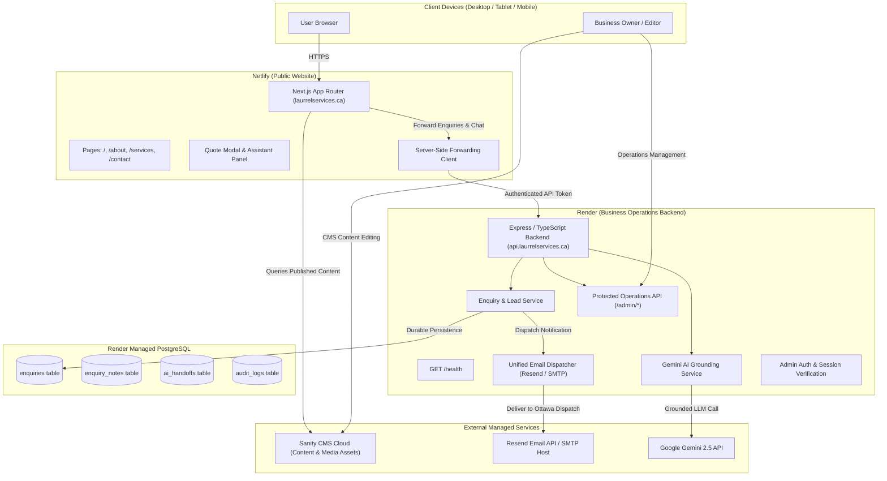

# LAURREL SERVICES — ARCHITECTURE & SECURITY AUDIT (PHASE 1)

**Date**: October 15, 2026  
**Auditor**: Antigravity Autonomous Engineering Agent  
**Target Repository**: `https://github.com/AleleChi/laurrel.git`  
**Target Hosting Architecture**:
- Frontend: Netlify (Next.js App Router)
- Backend API: Render (Dedicated Express/TypeScript Service)
- Database: PostgreSQL on Render (Managed Relational Persistence)
- CMS: Sanity Cloud (Standalone Studio + ISR Content Hydration)
- Email: Resend (Ottawa Dispatch Notification & Customer Acknowledgements)
- AI Assistant: Google Gemini 2.5-flash with Local Rule-Based Grounding Fallback

---

## 1. Executive Summary

This architecture and security audit has been performed on the local repository at `c:\Users\alele\Desktop\laurrel` prior to structural extraction and deployment. The codebase represents a high-fidelity, design-approved Next.js 14 web application for **LAURREL SERVICES**, an Ottawa-focused provider of Cleaning, Moving, and Transitional Storage services.

All core design tokens, brand palettes (`#390044` deep purple, `#C8E80B` lime, `#F8F7F4` warm white, `#202024` ink), video hero carousels, responsive navigation layouts, contact/quote modals, and Gemini AI assistant interfaces are already implemented and visually verified.

However, several server-side and operational components are currently implemented using local file persistence (`data/*.json`) or in-memory mechanisms suitable only for development:
1. Customer enquiries and lead records are persisted locally via Node.js `fs` to `data/enquiries.json`.
2. Billing quotations, invoices, and webhook records are stored in `data/quotes.json`, `data/invoices.json`, and `data/billing_webhooks.json`.
3. Email delivery is partially implemented via direct `fetch` to Resend's REST API without abstraction for SMTP, fallback queues, or customer delivery receipts.
4. Administrative authentication is currently split: Sanity Studio leverages hosted OAuth authentication, but no protected operational dashboard or role-based session system exists for viewing enquiries, AI handoffs, or managing quotation approvals.
5. Next.js image domain configuration lacks `cdn.sanity.io` in `next.config.mjs`, which would cause runtime exceptions when editors upload photos to Sanity.

---

## 2. Package & Dependency Review

### Root Application (`package.json`)
- **Framework**: `next@^14.2.18`, `react@^18.3.1`, `react-dom@^18.3.1`
- **TypeScript**: `typescript@^5.6.3`, `@types/node@^20.17.6`, `@types/react@^18.3.12`
- **Styling & UI**: `tailwindcss@^3.4.15`, `framer-motion@^11.11.17`, `lucide-react@^0.454.0`, `clsx@^2.1.1`, `tailwind-merge@^2.5.4`
- **Image Optimization**: `sharp@^0.35.5`
- **AI Integration**: `@google/genai@^2.30.0`
- **CMS Integration**: `@sanity/client@^8.9.0`, `@sanity/image-url@^2.1.1`
- **Testing & Tooling**: `puppeteer@^25.13.0`, `ffmpeg-static@^5.3.0`

### Sanity Studio (`studio/package.json`)
- Isolated workspace in `studio/` directory to avoid React 19 / Next.js peer-dependency collisions.
- Dependencies: `sanity@^3.73.0`, `styled-components@^6.1.13`
- Configured with `sanity.cli.ts` and `sanity.config.ts`.

---

## 3. Next.js Configuration Analysis (`next.config.mjs`)

```javascript
/** @type {import('next').NextConfig} */
const nextConfig = {
  reactStrictMode: true,
  images: {
    formats: ['image/avif', 'image/webp'],
  },
};
export default nextConfig;
```
**Audit Finding & Required Fix**:
- The current image configuration supports AVIF and WebP optimization, but does **not** declare `cdn.sanity.io` in `images.remotePatterns`.
- When editors publish photos to Sanity, URLs from `https://cdn.sanity.io/...` will be rejected by Next.js `<Image>`.
- **Remediation**: Add `remotePatterns: [{ protocol: 'https', hostname: 'cdn.sanity.io' }]` to `next.config.mjs`.

---

## 4. Source Structure & API Routes

```text
laurrel/
├── src/
│   ├── app/
│   │   ├── page.tsx               # Homepage with Hero, Ticker, About, Services, Overlap, FAQ, Contact
│   │   ├── about/page.tsx         # Dedicated About Page
│   │   ├── services/page.tsx      # Reconstructed Services Page with Sticky Nav & Sidebar Form
│   │   ├── contact/page.tsx       # Reconstructed Contact Page with Google Maps fallback
│   │   └── api/
│   │       ├── enquire/route.ts   # In-memory rate limiting, validation, local JSON write, Resend API
│   │       ├── assistant/chat/    # Gemini 2.5-flash / local fallback assistant engine
│   │       └── billing/webhook/   # Stripe webhook handler writing to local JSON
│   ├── components/
│   │   ├── assistant/             # LaurrelAssistantPanel & Chat Launcher UI
│   │   ├── forms/                 # AccessibleDialog, FormInput, ServiceMultiSelect, SubmitButton
│   │   ├── home/                  # Hero, HeroVideoRotator, ServiceTicker, WhenPlansOverlap, etc.
│   │   ├── layout/                # SiteHeader (responsive dropdown), SiteFooter
│   │   └── ui/                    # Button, Logo, QuoteInquiryModal
│   ├── content/
│   │   └── site.ts                # Centralized typed fallback content & siteConfig
│   ├── lib/
│   │   ├── assistant/             # engine.ts, knowledge.ts, types.ts
│   │   ├── billing/               # calculator.ts (HST 13%), service.ts
│   │   ├── db/                    # enquiries.ts (File-backed storage in data/enquiries.json)
│   │   ├── types/                 # enquiry.ts, billing.ts
│   │   └── validation/            # enquiry.ts
│   └── sanity/
│       ├── client.ts              # getHomeAboutData, getHomeServicesData, getAboutPageData, etc.
│       ├── image.ts               # urlFor image helper
│       └── schemaTypes/           # siteSettings, homeAbout, homeServices, aboutPage, servicesPage, contactPage
├── studio/                        # Standalone Sanity Studio v3 workspace
├── public/assets/                 # Video MP4s, posters, photography, illustrations
├── data/                          # Local JSON data directory (enquiries, quotes, invoices) [GIT IGNORED]
└── docs/                          # Screenshots, audits, references
```

---

## 5. Security & Secret Exposure Audit

A comprehensive pattern scan and Git history search was conducted across all tracked files, untracked directories, and historical commits:

| Scan Target | Result | Status | Notes |
| :--- | :--- | :--- | :--- |
| `.env`, `.env.local`, `.env.production` | Not tracked, not present on disk | **CLEAN** | Only `.env.example` exists with empty placeholders. |
| Hardcoded API Keys (`AIza*`, `sk-*`, `ghp_*`) | None found in code | **CLEAN** | All API key lookups use `process.env.*`. |
| Database Credentials (`postgres://`) | None found in code | **CLEAN** | Referenced only as environment documentation. |
| Customer Submissions / PII in Git | Commit `3d544a8` contained mock test records in `data/enquiries.json`; removed in `570ba33`. | **CLEAN** | Data contained mock `david.sterling@example.ca`. `data/` is now permanently in `.gitignore`. |
| Untracked `data/` directory | 4 local JSON files present on disk | **IGNORED** | Verified `git status --ignored` outputs `!! data/`. |
| Outbound API calls | Resend and Gemini endpoints | **VERIFIED** | Secret keys are read strictly from server-side environment variables. |

---

## 6. Current Implementation vs. Scaffolded Feature Matrix

| Functional Area | Current Status | Implemented | Scaffolded / Incomplete | Production Requirement |
| :--- | :--- | :---: | :---: | :--- |
| **Frontend UI & Pages** | Complete | Yes | No | Deploy to Netlify. |
| **Video Rotator** | Complete | Yes | No | Hero crossfade between Cleaning, Moving, Storage with posters. |
| **Enquiry Forms** | Complete UI | Yes | Partial | Connect to Render Backend API & PostgreSQL. |
| **Enquiry Persistence** | File-backed | Partial | Yes | Migrate `data/enquiries.json` to PostgreSQL table. |
| **Email Delivery** | Partial | Partial | Yes | Create unified email abstraction (Resend + SMTP options). |
| **AI Assistant** | Complete | Yes | No | Move chat processing to Render Backend to protect keys. |
| **Sanity Content Client**| Complete | Yes | No | Ensure video and hero media fields are registered in Studio. |
| **Sanity Studio** | Standalone v3 | Yes | Dependencies installed | Deploy hosted Studio to `laurrel.sanity.studio`. |
| **Operations Dashboard** | Not implemented | No | Yes | Build protected `/admin` dashboard on Render / Next.js. |
| **Billing & Invoices** | Domain Logic Ready | Yes | Scaffolded | Keep safety gates active; live dispatch withheld until approved. |

---

## 7. Target Production Architecture



---

## 8. Migration Plan & Next Actions

1. **Git & Remote Setup**: Add `https://github.com/AleleChi/laurrel.git` as `origin`, rename branch to `main`, prepare comprehensive documentation, and push.
2. **Dedicated Backend Workspace (`backend/`)**:
   - Initialize dedicated Node.js/TypeScript Express backend for Render deployment.
   - Implement `GET /health`, `POST /api/enquire`, `POST /api/assistant/chat`, and administrative enquiry queries.
3. **PostgreSQL Migration**:
   - Create relational schema (`enquiries`, `internal_notes`, `ai_handoffs`).
   - Implement connection pooling and automated migration scripts.
4. **Unified Email Abstraction**:
   - Support `EMAIL_PROVIDER=resend` (default) and `EMAIL_PROVIDER=smtp`.
   - Implement structured Ottawa dispatch notification and customer acknowledgement.
5. **Sanity Media Enhancement**:
   - Register hero service video and poster schema in Sanity Studio.
   - Generate complete `docs/cms/media-inventory.md`.
6. **Netlify Frontend Deployment**:
   - Configure Netlify build pipeline and API forwarding client.
7. **Verification & Production QA**:
   - Perform end-to-end multi-device submission, delivery, and CMS testing.
